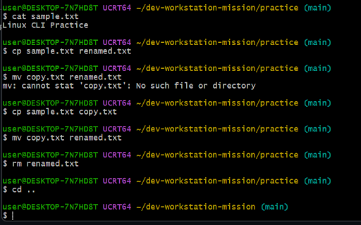
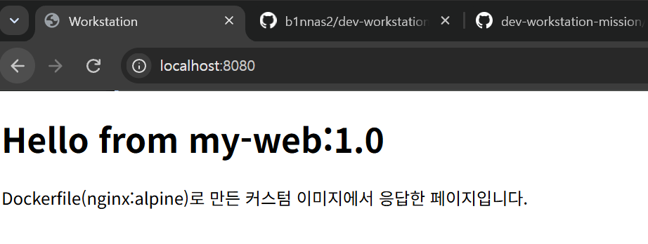
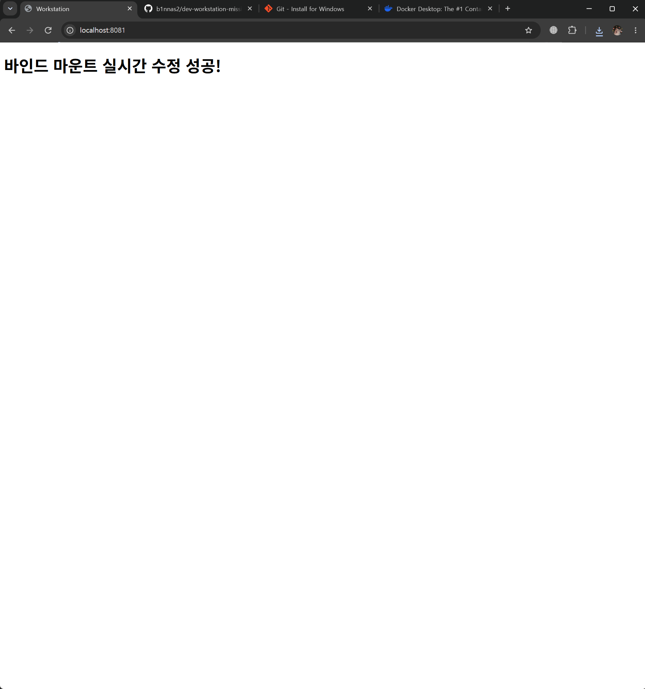
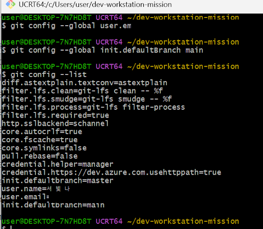
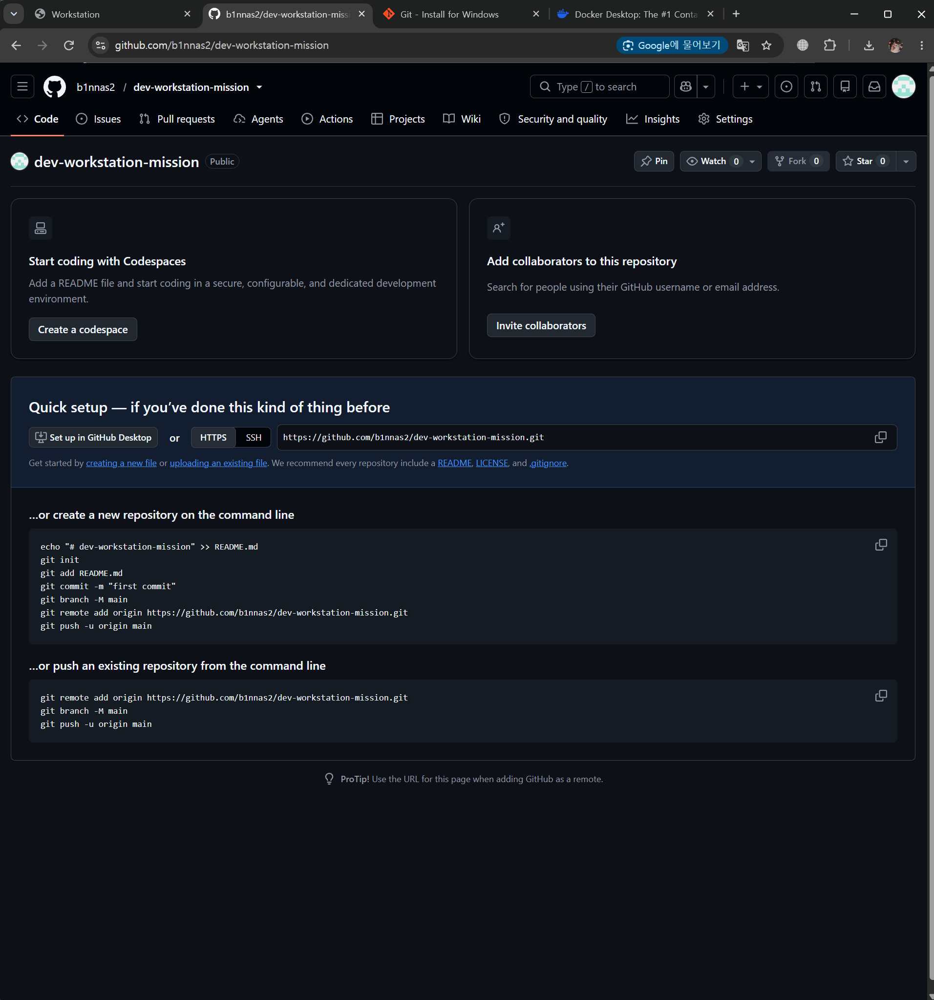
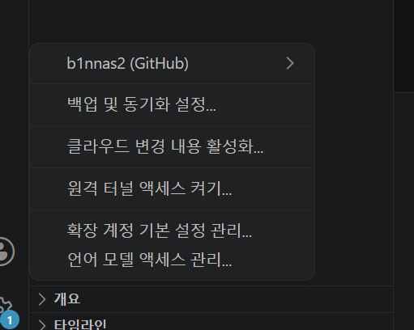
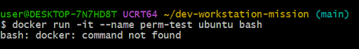
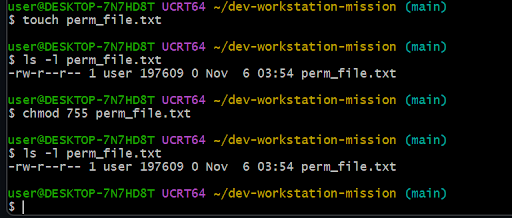
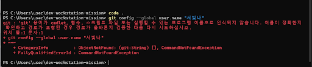

# 개발 워크스테이션 구축 미션 (Linux CLI · Docker · Git/GitHub)

> 저장소: https://github.com/b1nnas2/dev-workstation-mission
> 이 README 하나로 **수행 내용 · 명령어와 출력 · 스크린샷 · 재현 방법 · 개념 설명 · 트러블슈팅**을 모두 볼 수 있습니다.
> 모든 로그는 `scripts/collect_evidence.sh`가 실제로 실행한 **명령어 + 출력 그대로**이며, 원본은 [`logs/`](logs/) 폴더에도 있습니다.

## 목차
1. [프로젝트 개요](#1-프로젝트-개요)
2. [실행 환경](#2-실행-환경)
3. [디렉토리 구조와 각 파일의 역할](#3-디렉토리-구조와-각-파일의-역할)
4. [수행 항목 체크리스트](#4-수행-항목-체크리스트)
5. [재현 절차 (평가자용)](#5-재현-절차-평가자용)
6. [수행 로그 및 검증 증거](#6-수행-로그-및-검증-증거)
7. [개념 정리](#7-개념-정리)
8. [트러블슈팅](#8-트러블슈팅)
9. [보안 및 개인정보 보호](#9-보안-및-개인정보-보호)
10. [보너스: Docker Compose · 환경 변수](#10-보너스-docker-compose--환경-변수)

---

## 1. 프로젝트 개요

"내 컴퓨터에서만 돌아가는" 문제를 줄이기 위해, 누구나 같은 절차로 실행·검증할 수 있는 개발 환경을 직접 구성했습니다.

| 영역 | 한 일 | 증거 |
|---|---|---|
| 터미널 | 경로 확인, 숨김 파일 목록, 생성·복사·이동·이름변경·삭제, 빈 파일 생성 | [6.1](#61-터미널-기본-조작) |
| 권한 | 파일 1개(644→755→640), 디렉토리 1개(755→700) 권한 변경 전/후 비교 | [6.2](#62-권한-실습-파일-1개--디렉토리-1개) |
| Docker | 설치·데몬 점검, hello-world, ubuntu 진입, 이미지/컨테이너 운영 명령 | [6.3](#63-docker-설치-및-데몬-점검) ~ [6.7](#67-docker-기본-운영-명령-images--ps--logs--stats) |
| Dockerfile | `nginx:alpine` 기반 커스텀 이미지 `my-web:1.0` 빌드 | [6.5](#65-dockerfile-커스텀-이미지-빌드) |
| 포트 | 같은 이미지를 8080, 8082 두 포트로 실행하고 접속 확인 | [6.6](#66-포트-매핑-및-접속-확인-2회) |
| 바인드 마운트 | 호스트 파일 수정 → 재빌드 없이 즉시 반영 (전/후 비교) | [6.8](#68-바인드-마운트-변경-반영-전후-비교) |
| 볼륨 | 컨테이너 삭제 전/후 데이터 유지 + 백업/복구 | [6.9](#69-docker-볼륨-영속성--백업복구) |
| Git/GitHub | 사용자·기본 브랜치 설정, 원격 연동, push, VSCode 연동 | [6.11](#611-git-설정-및-github--vscode-연동) |

---

## 2. 실행 환경

| 항목 | 값 |
|---|---|
| OS | Windows 11 Home (x86_64) |
| Shell / Terminal | Git Bash (MINGW64/UCRT64), 일부 PowerShell |
| Docker | Docker Desktop (WSL 2 백엔드) — 정확한 버전은 아래 로그 |
| Git | Git for Windows 2.56.x — 정확한 버전은 아래 로그 |
| 에디터 | Visual Studio Code |

<!-- LOG:00_env -->
```text
$ uname -a
MINGW64_NT-10.0-26200 DESKTOP-7N7HD8T 3.6.10-5a1665c8.x86_64 2026-09-28 10:40 UTC x86_64 Msys

$ echo "SHELL=$SHELL"
SHELL=/usr/bin/bash

$ bash --version | head -n 1
GNU bash, version 5.3.15(2)-release (x86_64-pc-cygwin)

$ docker --version
Docker version 29.9.2, build a82e528

$ git --version
git version 2.56.0.windows.4

```
<!-- /LOG -->

> **다른 환경에서 재현할 때 주의**
> - **macOS / 서울캠퍼스(OrbStack)**: OrbStack 앱을 켜 두면 `docker` 명령을 그대로 쓸 수 있습니다. sudo 불필요. 스크립트 그대로 동작합니다.
> - **Linux**: 사용자가 `docker` 그룹에 없으면 `sudo docker ...`가 필요할 수 있습니다.
> - **Windows Git Bash**: `/data` 같은 리눅스 경로가 `C:/Program Files/Git/data`로 바뀌는 문제가 있어 스크립트에서 `MSYS_NO_PATHCONV=1`을 설정했습니다 ([트러블슈팅 #5](#트러블슈팅-5-git-bash가-컨테이너-내부-경로를-windows-경로로-바꿈)).

---

## 3. 디렉토리 구조와 각 파일의 역할

```text
dev-workstation-mission/
├── README.md                  # 기술 문서 (지금 보고 있는 파일)
├── Dockerfile                 # nginx:alpine 기반 커스텀 웹 서버 이미지 정의
├── .dockerignore              # 빌드 컨텍스트에서 제외할 파일 (이미지에 불필요한 파일 차단)
├── docker-compose.yml         # (보너스) web + checker 멀티 컨테이너 실행 설정
├── .gitattributes             # .sh/.md 를 LF 로 고정 (Windows CRLF 문제 방지)
├── .gitignore                 # backup/ 등 커밋하지 않을 파일
├── site/
│   └── index.html             # 이미지에 COPY 되는 웹 페이지 (이미지에 "구워지는" 콘텐츠)
├── bind-site/
│   └── index.html             # 바인드 마운트 실습용 (호스트에서 수정 → 컨테이너에 즉시 반영)
├── practice/                  # 터미널·권한 실습 결과물
├── scripts/
│   ├── collect_evidence.sh    # 전체 실습 실행 + 로그 저장 + README 자동 삽입
│   └── perm_lab.sh            # ubuntu 컨테이너 안에서 실행하는 권한 실습
├── logs/                      # 각 실습의 "명령어 + 출력" 원본 (00_env.txt ~ 12_bonus_compose.txt)
└── images/                    # 스크린샷 (브라우저 접속, VSCode 연동, 트러블슈팅)
```

**구성 기준**
- `site/`(이미지에 넣는 콘텐츠)와 `bind-site/`(실행 중에 바꾸는 콘텐츠)를 **분리**했습니다. 같은 폴더를 쓰면 "이미지에 들어간 것"과 "마운트로 덮어쓴 것"이 구분되지 않아 검증이 애매해지기 때문입니다.
- 실행 절차는 사람이 매번 타이핑하지 않도록 `scripts/`에 모았고, 결과는 `logs/`에 남겨 **누가 실행해도 같은 증거가 나오도록** 했습니다.
- `.dockerignore`로 `.git`, `images/`, `logs/` 등을 빌드 컨텍스트에서 빼서 이미지가 `site/`만 담도록 했습니다.

---

## 4. 수행 항목 체크리스트

- [x] 터미널 기본 조작 (pwd, ls -la, cd, mkdir, touch, echo, cat, cp, mv, rm, rmdir) — [6.1](#61-터미널-기본-조작)
- [x] 권한 변경 실습: 파일 1개 + 디렉토리 1개, 전/후 비교 — [6.2](#62-권한-실습-파일-1개--디렉토리-1개)
- [x] Docker 설치/점검 (`docker --version`, `docker info`) — [6.3](#63-docker-설치-및-데몬-점검)
- [x] hello-world 실행, ubuntu 컨테이너 진입 및 명령 실행, attach/exec 차이 관찰 — [6.4](#64-컨테이너-실행-실습-hello-world--ubuntu--attachexec)
- [x] Dockerfile 커스텀 이미지 빌드/실행 — [6.5](#65-dockerfile-커스텀-이미지-빌드)
- [x] 포트 매핑 접속 (2회: 8080, 8082) + 브라우저 스크린샷 — [6.6](#66-포트-매핑-및-접속-확인-2회)
- [x] Docker 운영 명령 (images, ps, ps -a, stop/start, logs, stats) — [6.7](#67-docker-기본-운영-명령-images--ps--logs--stats)
- [x] 바인드 마운트 변경 반영 (전/후) — [6.8](#68-바인드-마운트-변경-반영-전후-비교)
- [x] 볼륨 영속성 (컨테이너 삭제 전/후) + 백업/복구 — [6.9](#69-docker-볼륨-영속성--백업복구)
- [x] 포트 충돌 진단 및 해결 — [6.10](#610-포트-충돌-진단-및-해결)
- [x] Git 설정 + GitHub 원격 연동/push + VSCode 연동 — [6.11](#611-git-설정-및-github--vscode-연동)
- [x] 트러블슈팅 5건 (가설 → 확인 → 조치, 증거 포함) — [8](#8-트러블슈팅)
- [x] (보너스) Docker Compose 단일/멀티 컨테이너, up/down/ps/logs, 환경 변수 — [10](#10-보너스-docker-compose--환경-변수)

---

## 5. 재현 절차 (평가자용)

**준비물**: Git, Docker(Docker Desktop 또는 OrbStack 실행 중), bash(Windows는 Git Bash), curl

```bash
# 1) 저장소 받기
git clone https://github.com/b1nnas2/dev-workstation-mission.git
cd dev-workstation-mission

# 2) 전체 실습을 한 번에 실행 (로그가 logs/ 에 저장되고 README 에 자동으로 붙음)
bash scripts/collect_evidence.sh

# 3) 브라우저 확인
#    http://localhost:8080  (커스텀 이미지, 1번째 매핑)
#    http://localhost:8082  (커스텀 이미지, 2번째 매핑)
#    http://localhost:8081  (바인드 마운트, bind-site/index.html 내용)

# 4) 정리
bash scripts/collect_evidence.sh clean
```

**수동으로 하나씩 재현하고 싶다면** (핵심 명령만)

```bash
# 커스텀 이미지 빌드 + 포트 매핑 (호스트 8080 -> 컨테이너 80)
docker build -t my-web:1.0 .
docker run -d -p 8080:80 --name web-8080 my-web:1.0
curl http://localhost:8080

# 바인드 마운트 (호스트 폴더는 반드시 절대 경로)
docker run -d -p 8081:80 -v "$(pwd)/bind-site:/usr/share/nginx/html" --name web-bind nginx:alpine
echo "<h1>changed</h1>" > bind-site/index.html
curl http://localhost:8081          # 바로 changed 가 보임

# 볼륨 영속성
docker volume create mydata
docker run -d --name vol-test -v mydata:/data ubuntu sleep infinity
docker exec vol-test bash -c "echo hi > /data/hello.txt"
docker rm -f vol-test
docker run --rm -v mydata:/data ubuntu cat /data/hello.txt   # hi
```

> Windows Git Bash에서 수동 실행 시: 먼저 `export MSYS_NO_PATHCONV=1`, 바인드 경로는 `"$(pwd -W)/bind-site"` 사용. 대화형 진입은 `winpty docker run -it ubuntu bash`.
> 포트가 이미 사용 중이면 [6.10](#610-포트-충돌-진단-및-해결) 절차로 진단 후 다른 호스트 포트를 쓰면 됩니다.

---

## 6. 수행 로그 및 검증 증거

### 6.1 터미널 기본 조작

**확인 포인트**: `ls -la`에서 `.git`, `.` `..` 같은 숨김 항목이 보이는지 / `cp`·`mv`·`rm` 이후 목록이 기대대로 바뀌는지 / 상대 경로(`cd practice`)와 절대 경로(`cd /c/Users/...`) 이동이 모두 되는지.

<!-- LOG:01_terminal -->
```text
# 현재 위치 / 숨김 파일 포함 목록
$ pwd
/c/Users/user/dev-mission-new

$ ls -la
total 63
drwxr-xr-x 1 user 197609     0 Nov 11 04:24 .
drwxr-xr-x 1 user 197609     0 Nov 11 04:15 ..
-rw-r--r-- 1 user 197609    56 Nov 10 13:27 .dockerignore
drwxr-xr-x 1 user 197609     0 Nov 11 04:15 .git
-rw-r--r-- 1 user 197609   197 Nov 10 13:27 .gitattributes
-rw-r--r-- 1 user 197609    37 Nov 10 13:27 .gitignore
-rw-r--r-- 1 user 197609  1164 Nov 10 13:26 Dockerfile
-rw-r--r-- 1 user 197609 28278 Nov 10 13:29 README.md
-rw-r--r-- 1 user 197609   680 Nov 10 13:27 docker-compose.yml
drwxr-xr-x 1 user 197609     0 Nov 11 04:24 images
drwxr-xr-x 1 user 197609     0 Nov 11 04:25 logs
drwxr-xr-x 1 user 197609     0 Nov 11 04:24 scripts
drwxr-xr-x 1 user 197609     0 Nov 11 04:24 site

# 디렉토리 생성 후 이동 (상대 경로)
$ mkdir -p practice/sub

$ cd practice

$ pwd
/c/Users/user/dev-mission-new/practice

# 빈 파일 생성 / 내용 작성 / 내용 확인
$ touch empty.txt

$ echo "Linux CLI Practice" > sample.txt

$ cat sample.txt
Linux CLI Practice

$ ls -la
total 5
drwxr-xr-x 1 user 197609  0 Nov 11 04:25 .
drwxr-xr-x 1 user 197609  0 Nov 11 04:25 ..
-rw-r--r-- 1 user 197609  0 Nov 11 04:25 empty.txt
-rw-r--r-- 1 user 197609 19 Nov 11 04:25 sample.txt
drwxr-xr-x 1 user 197609  0 Nov 11 04:25 sub

# 복사 -> 이름 변경 -> 다른 폴더로 이동
$ cp sample.txt copy.txt

$ mv copy.txt renamed.txt

$ mv renamed.txt sub/

$ ls -la . sub
.:
total 5
drwxr-xr-x 1 user 197609  0 Nov 11 04:25 .
drwxr-xr-x 1 user 197609  0 Nov 11 04:25 ..
-rw-r--r-- 1 user 197609  0 Nov 11 04:25 empty.txt
-rw-r--r-- 1 user 197609 19 Nov 11 04:25 sample.txt
drwxr-xr-x 1 user 197609  0 Nov 11 04:25 sub

sub:
total 1
drwxr-xr-x 1 user 197609  0 Nov 11 04:25 .
drwxr-xr-x 1 user 197609  0 Nov 11 04:25 ..
-rw-r--r-- 1 user 197609 19 Nov 11 04:25 renamed.txt

# 삭제 (파일 -> 빈 디렉토리)
$ rm sub/renamed.txt

$ rmdir sub

$ ls -la
total 5
drwxr-xr-x 1 user 197609  0 Nov 11 04:25 .
drwxr-xr-x 1 user 197609  0 Nov 11 04:25 ..
-rw-r--r-- 1 user 197609  0 Nov 11 04:25 empty.txt
-rw-r--r-- 1 user 197609 19 Nov 11 04:25 sample.txt

# 절대 경로로 저장소 루트 복귀
$ cd "/c/Users/user/dev-mission-new"

$ pwd
/c/Users/user/dev-mission-new

```
<!-- /LOG -->

처음 수동으로 실습할 때의 Git Bash 화면 (명령 + 출력):



### 6.2 권한 실습 (파일 1개 + 디렉토리 1개)

**확인 포인트**: `chmod` 전/후 `ls -l` 첫 칸이 바뀌는지, `stat`의 숫자 표기(644/755/700)가 기호 표기와 일치하는지, 700 디렉토리에 다른 사용자가 접근하면 거부되는지.

- Windows NTFS 위에서는 `chmod`가 반영되지 않아([트러블슈팅 #2](#트러블슈팅-2-git-bash에서-chmod-755-를-해도-권한이-안-바뀜)) **Linux 컨테이너 안에서** 실험했습니다. 호스트 시도 결과도 함께 남겼습니다.

<!-- LOG:02_permission -->
```text
# [A] 호스트(Windows Git Bash, NTFS)에서 시도 -> 권한 비트가 바뀌지 않음 (트러블슈팅 #2)
#     macOS/Linux 호스트에서는 정상적으로 바뀜
$ touch practice/perm_host.txt && ls -l practice/perm_host.txt
-rw-r--r-- 1 user 197609 0 Nov 11 04:25 practice/perm_host.txt

$ chmod 755 practice/perm_host.txt && ls -l practice/perm_host.txt
-rw-r--r-- 1 user 197609 0 Nov 11 04:25 practice/perm_host.txt

# [B] Linux(ubuntu) 컨테이너 안에서 파일 1개 + 디렉토리 1개 권한 변경 실험
$ tr -d "\r" < scripts/perm_lab.sh | docker run --rm -i ubuntu bash
$ cd /tmp
$ touch perm_file.txt
$ chmod 644 perm_file.txt
$ ls -l perm_file.txt
-rw-r--r-- 1 root root 0 Nov 10 19:25 perm_file.txt
$ chmod 755 perm_file.txt
$ ls -l perm_file.txt
-rwxr-xr-x 1 root root 0 Nov 10 19:25 perm_file.txt
$ chmod u=rw,g=r,o= perm_file.txt
$ ls -l perm_file.txt
-rw-r----- 1 root root 0 Nov 10 19:25 perm_file.txt
$ stat -c '%a %A %n' perm_file.txt
640 -rw-r----- perm_file.txt
$ mkdir perm_dir
$ chmod 755 perm_dir
$ ls -ld perm_dir
drwxr-xr-x 2 root root 4096 Nov 10 19:25 perm_dir
$ chmod 700 perm_dir
$ ls -ld perm_dir
drwx------ 2 root root 4096 Nov 10 19:25 perm_dir
$ stat -c '%a %A %n' perm_dir
700 drwx------ perm_dir
$ su -s /bin/bash nobody -c 'ls /tmp/perm_dir'
ls: cannot open directory '/tmp/perm_dir': Permission denied
$ true

```
<!-- /LOG -->

| 대상 | 변경 전 | 변경 후 | 의미 |
|---|---|---|---|
| perm_file.txt | `644` `-rw-r--r--` | `755` `-rwxr-xr-x` | 모두에게 실행(x) 권한 추가 |
| perm_file.txt | `755` | `640` `-rw-r-----` | 기타 사용자 권한 전부 제거 |
| perm_dir/ | `755` `drwxr-xr-x` | `700` `drwx------` | 소유자만 목록 보기/진입 가능 |

### 6.3 Docker 설치 및 데몬 점검

**확인 포인트**: `docker --version`(클라이언트) / `docker info`에 `Server:` 섹션과 `Server Version`이 나오면 데몬이 살아 있음. 데몬이 꺼져 있으면 `Cannot connect to the Docker daemon` 오류가 납니다.

<!-- LOG:03_docker_check -->
```text
$ docker --version
Docker version 29.9.2, build a82e528

$ docker version --format "Client {{.Client.Version}} / Server {{.Server.Version}} ({{.Server.Os}}/{{.Server.Arch}})"
Client 29.9.2 / Server 29.9.2 (linux/amd64)

# docker info: Server 섹션이 출력되면 데몬이 정상 동작 중
$ docker info | sed -E "s/(Username: ).*/\1***masked***/"
Client:
 Version:    29.9.2
 Context:    desktop-linux
 Debug Mode: false
 Plugins:
  agent: Docker AI Agent Runner (Docker Inc.)
    Version:  v1.152.0
    Path:     C:\Users\user\.docker\cli-plugins\docker-agent.exe
  ai: Docker AI Agent - Ask Gordon (Docker Inc.)
    Version:  v1.33.0
    Path:     C:\Users\user\.docker\cli-plugins\docker-ai.exe
  buildx: Docker Buildx (Docker Inc.)
    Version:  v0.38.1
    Path:     C:\Users\user\.docker\cli-plugins\docker-buildx.exe
  compose: Docker Compose (Docker Inc.)
    Version:  v5.6.1
    Path:     C:\Users\user\.docker\cli-plugins\docker-compose.exe
  debug: Get a shell into any image or container (Docker Inc.)
    Version:  0.49.0
    Path:     C:\Users\user\.docker\cli-plugins\docker-debug.exe
  desktop: Docker Desktop commands (Docker Inc.)
    Version:  4.98.0
    Path:     C:\Users\user\.docker\cli-plugins\docker-desktop.exe
  dhi: CLI for managing Docker Hardened Images (Docker Inc.)
    Version:  v0.0.9
    Path:     C:\Users\user\.docker\cli-plugins\docker-dhi.exe
  extension: Manages Docker extensions (Docker Inc.)
    Version:  v0.2.32
    Path:     C:\Users\user\.docker\cli-plugins\docker-extension.exe
  init: Creates Docker-related starter files for your project (Docker Inc.)
    Version:  v1.4.1
    Path:     C:\Users\user\.docker\cli-plugins\docker-init.exe
  mcp: Docker MCP Plugin (Docker Inc.)
    Version:  v0.44.2
    Path:     C:\Users\user\.docker\cli-plugins\docker-mcp.exe
  model: Docker Model Runner (Docker Inc.)
    Version:  v1.2.9
    Path:     C:\Users\user\.docker\cli-plugins\docker-model.exe
  offload: Docker Offload (Docker Inc.)
    Version:  v0.7.35
    Path:     C:\Users\user\.docker\cli-plugins\docker-offload.exe
  pass: Docker Pass Secrets Manager Plugin (beta) (Docker Inc.)
    Version:  v0.3.2
    Path:     C:\Users\user\.docker\cli-plugins\docker-pass.exe
  sandbox: "docker sandbox" is deprecated, use Docker Sandboxes instead (Docker Inc.)
    Version:  v0.13.0
    Path:     C:\Users\user\.docker\cli-plugins\docker-sandbox.exe
  scout: Docker Scout (Docker Inc.)
    Version:  v1.27.0
    Path:     C:\Users\user\.docker\cli-plugins\docker-scout.exe

Server:
 Containers: 2
  Running: 0
  Paused: 0
  Stopped: 2
 Images: 3
 Server Version: 29.9.2
 Storage Driver: overlayfs
  driver-type: io.containerd.snapshotter.v1
 Logging Driver: local
 Cgroup Driver: cgroupfs
 Cgroup Version: 2
 Plugins:
  Volume: local
  Network: bridge host ipvlan macvlan null overlay
  Log: awslogs fluentd gcplogs gelf journald json-file local splunk syslog
 CDI spec directories:
  /etc/cdi
  /var/run/cdi
 Discovered Devices:
  cdi: docker.com/gpu=webgpu
 Swarm: inactive
 Runtimes: runc io.containerd.runc.v2 nvidia
 Default Runtime: runc
 Init Binary: docker-init
 containerd version: b7a25261e029d68978bbf290df0a62fc819b3c51
 runc version: v1.5.2-0-g29dd3dc2
 init version: de40ad0
 Security Options:
  seccomp
   Profile: builtin
  cgroupns
 Kernel Version: 6.18.58.1-microsoft-standard-WSL2
 Operating System: Docker Desktop
 OSType: linux
 Architecture: x86_64
 CPUs: 12
 Total Memory: 7.565GiB
 Name: docker-desktop
 ID: 92718566-4b34-4510-9fb4-fe559ee0e602
 Docker Root Dir: /var/lib/docker
 Debug Mode: false
 HTTP Proxy: http.docker.internal:3128
 HTTPS Proxy: http.docker.internal:3128
 No Proxy: hubproxy.docker.internal
 Labels:
  com.docker.desktop.address=npipe://\\.\pipe\docker_cli
 Experimental: false
 Insecure Registries:
  hubproxy.docker.internal:5555
  127.0.0.0/8
  ::1/128
 Live Restore Enabled: false
 Firewall Backend: iptables


```
<!-- /LOG -->

### 6.4 컨테이너 실행 실습 (hello-world · ubuntu · attach/exec)

<!-- LOG:04_containers -->
```text
# hello-world 실행
$ docker run --name hello-test hello-world
Unable to find image 'hello-world:latest' locally
latest: Pulling from library/hello-world
4f55086f7dd0: Pulling fs layer
4f55086f7dd0: Download complete
4f55086f7dd0: Pull complete
d5e71e642bf5: Download complete
Digest: sha256:c567b231f65614688711a75f31518a064258a51d442117a3e771a3a8fdba78ef
Status: Downloaded newer image for hello-world:latest

Hello from Docker!
This message shows that your installation appears to be working correctly.

To generate this message, Docker took the following steps:
 1. The Docker client contacted the Docker daemon.
 2. The Docker daemon pulled the "hello-world" image from the Docker Hub.
    (amd64)
 3. The Docker daemon created a new container from that image which runs the
    executable that produces the output you are currently reading.
 4. The Docker daemon streamed that output to the Docker client, which sent it
    to your terminal.

To try something more ambitious, you can run an Ubuntu container with:
 $ docker run -it ubuntu bash

Share images, automate workflows, and more with a free Docker ID:
 https://hub.docker.com/

For more examples and ideas, visit:
 https://docs.docker.com/get-started/


# ubuntu 컨테이너 실행(백그라운드 유지) 후 내부 명령 실행 (exec)
$ docker run -d --name ubuntu-test ubuntu sleep infinity
a87c43a0470ce83239cf4c1f848736d08a88e27eb2bd400cf647bd4cbd498dd6

$ docker exec ubuntu-test ls /
bin
boot
dev
etc
home
lib
lib64
media
mnt
opt
proc
root
run
sbin
srv
sys
tmp
usr
var

$ docker exec ubuntu-test bash -c "echo Hello from ubuntu container && head -n 2 /etc/os-release"
Hello from ubuntu container
PRETTY_NAME="Ubuntu 26.04.1 LTS"
NAME="Ubuntu"

# 관찰 1) exec 로 띄운 프로세스가 끝나도 컨테이너는 계속 Up (메인 프로세스 sleep 이 살아 있음)
$ docker ps --filter name=ubuntu-test
CONTAINER ID   IMAGE     COMMAND            CREATED        STATUS                  PORTS     NAMES
a87c43a0470c   ubuntu    "sleep infinity"   1 second ago   Up Less than a second             ubuntu-test

# 관찰 2) 메인 프로세스 자체가 끝나는 컨테이너는 즉시 Exited
$ docker run --name ubuntu-oneshot ubuntu echo "main process done"
main process done

$ docker ps -a --filter name=ubuntu-oneshot
CONTAINER ID   IMAGE     COMMAND                   CREATED                  STATUS                              PORTS     NAMES
f7717dfe1794   ubuntu    "echo 'main process …"   Less than a second ago   Exited (0) Less than a second ago             ubuntu-oneshot

# 관찰 3) attach 는 "메인 프로세스"의 입출력에 붙음 -> 메인 프로세스가 끝나면 attach 도 끝나고 컨테이너도 종료
$ docker run -d --name attach-test ubuntu bash -c 'for i in 1 2 3; do echo tick $i; sleep 1; done'
7377cdb6819fd3628cdeb017c44f1ae1267a46047f033ace0c03581eac8bf881

$ docker attach --no-stdin attach-test
tick 2
tick 3

$ docker ps -a --filter name=attach-test
CONTAINER ID   IMAGE     COMMAND                   CREATED         STATUS                              PORTS     NAMES
7377cdb6819f   ubuntu    "bash -c 'for i in 1…"   3 seconds ago   Exited (0) Less than a second ago             attach-test

```
<!-- /LOG -->

**attach / exec 관찰 정리**

| | `docker exec` | `docker attach` |
|---|---|---|
| 무엇에 붙나 | 실행 중인 컨테이너에 **새 프로세스**를 추가로 띄움 | 컨테이너의 **메인 프로세스(PID 1)** 입출력에 연결 |
| 빠져나오면 | 그 프로세스만 끝남, 컨테이너는 계속 `Up` | 메인 프로세스가 끝나면 컨테이너도 `Exited` (`exit` 입력 시 종료됨, `Ctrl+P, Ctrl+Q`로 분리하면 유지) |
| 쓰임 | 디버깅, 내부 확인 (`docker exec -it 이름 bash`) | 포그라운드 프로그램 출력 보기 |

- 컨테이너의 수명 = **메인 프로세스의 수명**입니다. `sleep infinity`로 띄운 `ubuntu-test`는 계속 살아 있고, `echo`로 띄운 `ubuntu-oneshot`은 출력 후 바로 `Exited (0)`이 됐습니다.
- 대화형 진입은 `docker run -it --name u1 ubuntu bash` → 안에서 `ls`, `echo hi` → `exit` 하면 컨테이너가 종료됩니다(메인 프로세스가 bash 였기 때문).

### 6.5 Dockerfile 커스텀 이미지 빌드

**선택한 베이스**: 공식 `nginx:alpine` 이미지 (방식 A: 웹 서버 베이스 + 콘텐츠/설정 교체)

| 커스텀 포인트 | Dockerfile | 목적 |
|---|---|---|
| 메타데이터 | `LABEL org.opencontainers.image.title=... maintainer=...` | 이미지 출처/이름 식별 (`docker image inspect`로 확인) |
| 환경 변수 | `ENV APP_ENV=production` | 실행 모드를 코드 밖 설정으로 분리 (Compose에서 덮어쓰기 실습) |
| 콘텐츠 교체 | `COPY site/ /usr/share/nginx/html/` | nginx 기본 페이지를 내 페이지로 교체 |
| 헬스체크 | `HEALTHCHECK ... wget http://localhost/` | 프로세스가 떠 있는 것뿐 아니라 **실제로 응답하는지** 자동 검사 |
| 포트 문서화 | `EXPOSE 80` | 컨테이너가 80번을 쓴다는 것을 명시 (실제 공개는 `-p`) |

<!-- LOG:05_build -->
```text
$ cat Dockerfile
# ------------------------------------------------------------
# 베이스: 공식 nginx:alpine 이미지 (기존 이미지 기반 커스텀 - 방식 A)
# ------------------------------------------------------------
FROM nginx:alpine

# [커스텀 1] 메타데이터: 이미지 이름/작성자 식별 (docker image inspect 로 확인 가능)
LABEL org.opencontainers.image.title="my-custom-nginx" \
      maintainer="b1nnas2"

# [커스텀 2] 환경변수: 실행 모드를 이미지에 기록 (코드와 설정 분리 연습)
ENV APP_ENV=production

# [커스텀 3] 정적 콘텐츠 교체: nginx 기본 페이지 -> 내 site/ 폴더
#   - site/ 는 "빌드 컨텍스트(.) 기준 상대 경로", 목적지는 "컨테이너 절대 경로"
COPY site/ /usr/share/nginx/html/

# [커스텀 4] 헬스체크: 컨테이너가 실제로 응답하는지 Docker가 주기적으로 검사
HEALTHCHECK --interval=5s --timeout=3s --start-period=3s --retries=3 \
  CMD wget -q -O /dev/null http://localhost/ || exit 1

# 컨테이너 내부에서 nginx가 듣는 포트 (문서화 목적, 실제 공개는 docker run -p 로 함)
EXPOSE 80

CMD ["nginx", "-g", "daemon off;"]

$ docker build --progress=plain -t my-web:1.0 .
#0 building with "desktop-linux" instance using docker driver

#1 [internal] load build definition from Dockerfile
#1 transferring dockerfile: 1.20kB 0.0s done
#1 DONE 0.0s

#2 [internal] load metadata for docker.io/library/nginx:alpine
#2 DONE 0.0s

#3 [internal] load .dockerignore
#3 transferring context: 96B done
#3 DONE 0.0s

#4 [internal] load build context
#4 transferring context: 330B done
#4 DONE 0.0s

#5 [1/2] FROM docker.io/library/nginx:alpine@sha256:b2f80f8f88146b0772fdcc7d92cea621aa8c2889fa8d07ed61d4884fcea53e09
#5 resolve docker.io/library/nginx:alpine@sha256:b2f80f8f88146b0772fdcc7d92cea621aa8c2889fa8d07ed61d4884fcea53e09 0.0s done
#5 CACHED

#6 [2/2] COPY site/ /usr/share/nginx/html/
#6 DONE 0.0s

#7 exporting to image
#7 exporting layers 0.1s done
#7 exporting manifest sha256:e5828ceb2066baa56395434c00f800d4264b93a2c0132a59cada8b3c39972353 0.0s done
#7 exporting config sha256:b2f75322e0168c6d60ef68f0da9a1eb28fdc065e1a0df0fdb79374150422b4e9 0.0s done
#7 exporting attestation manifest sha256:ab08078d68c9c424305d7442e89f47fecb6037fb38e16272b5676594aa9637ac 0.0s done
#7 exporting manifest list sha256:b54e6f7b302e0459efb7ebb91448f8f258c466634476a7faa4f00786b141da77 0.0s done
#7 naming to docker.io/library/my-web:1.0 done
#7 unpacking to docker.io/library/my-web:1.0 0.0s done
#7 DONE 0.2s

$ docker image inspect my-web:1.0 --format 'Labels={{json .Config.Labels}}  Env={{json .Config.Env}}  ExposedPorts={{json .Config.ExposedPorts}}'
Labels={"maintainer":"b1nnas2","org.opencontainers.image.title":"my-custom-nginx"}  Env=["PATH=/usr/local/sbin:/usr/local/bin:/usr/sbin:/usr/bin:/sbin:/bin","NGINX_VERSION=1.31.8","PKG_RELEASE=1","DYNPKG_RELEASE=1","NJS_VERSION=1.0.2","NJS_RELEASE=1","ACME_VERSION=0.4.1","APP_ENV=production"]  ExposedPorts={"80/tcp":{}}

```
<!-- /LOG -->

### 6.6 포트 매핑 및 접속 확인 (2회)

같은 이미지 `my-web:1.0`으로 컨테이너 2개를 띄우고, **호스트 포트만 다르게**(8080, 8082) 매핑했습니다. 컨테이너 안에서는 둘 다 80번입니다.

<!-- LOG:06_port -->
```text
# 같은 이미지로 컨테이너 2개를 서로 다른 호스트 포트에 매핑 (8080, 8082 -> 컨테이너 80)
$ docker run -d -p 8080:80 --name web-8080 my-web:1.0
b0d96ad4791a876695b41603a24117f9488edc3648d1d96464953bf6e0e136f4

$ docker run -d -p 8082:80 --name web-8082 my-web:1.0
a929d509cb164188ff0fc43dd94365fe9793192c0a911d2e68b683de89b4568d

$ docker ps --filter name=web-80
CONTAINER ID   IMAGE        COMMAND                   CREATED         STATUS                   PORTS                                     NAMES
a929d509cb16   my-web:1.0   "/docker-entrypoint.…"   3 seconds ago   Up 3 seconds (healthy)   0.0.0.0:8082->80/tcp, [::]:8082->80/tcp   web-8082
b0d96ad4791a   my-web:1.0   "/docker-entrypoint.…"   3 seconds ago   Up 3 seconds (healthy)   0.0.0.0:8080->80/tcp, [::]:8080->80/tcp   web-8080

$ docker port web-8080
80/tcp -> 0.0.0.0:8080
80/tcp -> [::]:8080

$ curl -s -i http://localhost:8080
HTTP/1.1 200 OK
Server: nginx/1.31.8
Date: Tue, 10 Nov 2026 19:25:49 GMT
Content-Type: text/html
Content-Length: 258
Last-Modified: Tue, 10 Nov 2026 04:26:16 GMT
Connection: keep-alive
ETag: "6af29ce8-102"
Accept-Ranges: bytes

<!DOCTYPE html>
<html lang="ko">
<head>
  <meta charset="utf-8">
  <title>Workstation</title>
</head>
<body>
  <h1>Hello from my-web:1.0</h1>
  <p>Dockerfile(nginx:alpine)로 만든 커스텀 이미지에서 응답한 페이지입니다.</p>
</body>
</html>

$ curl -s -i http://localhost:8082
HTTP/1.1 200 OK
Server: nginx/1.31.8
Date: Tue, 10 Nov 2026 19:25:49 GMT
Content-Type: text/html
Content-Length: 258
Last-Modified: Tue, 10 Nov 2026 04:26:16 GMT
Connection: keep-alive
ETag: "6af29ce8-102"
Accept-Ranges: bytes

<!DOCTYPE html>
<html lang="ko">
<head>
  <meta charset="utf-8">
  <title>Workstation</title>
</head>
<body>
  <h1>Hello from my-web:1.0</h1>
  <p>Dockerfile(nginx:alpine)로 만든 커스텀 이미지에서 응답한 페이지입니다.</p>
</body>
</html>

```
<!-- /LOG -->

**브라우저 접속 증거 (주소창 `localhost:8080` 포함)**



### 6.7 Docker 기본 운영 명령 (images · ps · logs · stats)

<!-- LOG:07_docker_ops -->
```text
$ docker pull nginx:alpine
alpine: Pulling from library/nginx
Digest: sha256:713fc2ebfd92e8217db451477182ee91944b123d2b1ee9fd5a8c6e91ca6c3a11
Status: Downloaded newer image for nginx:alpine
docker.io/library/nginx:alpine

$ docker images
IMAGE                ID             DISK USAGE   CONTENT SIZE   EXTRA
hello-world:latest   c567b231f656       25.9kB         9.49kB   U    
my-web:1.0           b54e6f7b302e       93.7MB         26.4MB   U    
nginx:alpine         713fc2ebfd92       94.5MB         27.3MB   U    
ubuntu:latest        6a06111c3b0a        163MB         45.9MB   U    

$ docker ps
CONTAINER ID   IMAGE        COMMAND                   CREATED          STATUS                   PORTS                                     NAMES
a929d509cb16   my-web:1.0   "/docker-entrypoint.…"   6 seconds ago    Up 6 seconds (healthy)   0.0.0.0:8082->80/tcp, [::]:8082->80/tcp   web-8082
b0d96ad4791a   my-web:1.0   "/docker-entrypoint.…"   6 seconds ago    Up 6 seconds (healthy)   0.0.0.0:8080->80/tcp, [::]:8080->80/tcp   web-8080
a87c43a0470c   ubuntu       "sleep infinity"          13 seconds ago   Up 13 seconds                                                      ubuntu-test

$ docker ps -a
CONTAINER ID   IMAGE          COMMAND                   CREATED          STATUS                      PORTS                                     NAMES
a929d509cb16   my-web:1.0     "/docker-entrypoint.…"   7 seconds ago    Up 6 seconds (healthy)      0.0.0.0:8082->80/tcp, [::]:8082->80/tcp   web-8082
b0d96ad4791a   my-web:1.0     "/docker-entrypoint.…"   7 seconds ago    Up 7 seconds (healthy)      0.0.0.0:8080->80/tcp, [::]:8080->80/tcp   web-8080
7377cdb6819f   ubuntu         "bash -c 'for i in 1…"   12 seconds ago   Exited (0) 8 seconds ago                                              attach-test
f7717dfe1794   ubuntu         "echo 'main process …"   13 seconds ago   Exited (0) 12 seconds ago                                             ubuntu-oneshot
a87c43a0470c   ubuntu         "sleep infinity"          14 seconds ago   Up 13 seconds                                                         ubuntu-test
f5d05143a70b   hello-world    "/hello"                  15 seconds ago   Exited (0) 14 seconds ago                                             hello-test
17087004e01f   ubuntu         "sleep infinity"          4 days ago       Exited (255) 7 hours ago                                              box2
2466e0999a27   b2f80f8f8814   "/docker-entrypoint.…"   4 days ago       Exited (255) 7 hours ago    0.0.0.0:8081->80/tcp                      web-mount

# 컨테이너 중지 / 재시작
$ docker stop web-8082
web-8082

$ docker ps -a --filter name=web-8082
CONTAINER ID   IMAGE        COMMAND                   CREATED         STATUS                              PORTS     NAMES
a929d509cb16   my-web:1.0   "/docker-entrypoint.…"   7 seconds ago   Exited (0) Less than a second ago             web-8082

$ docker start web-8082
web-8082

$ docker ps --filter name=web-8082
CONTAINER ID   IMAGE        COMMAND                   CREATED         STATUS                                     PORTS                                     NAMES
a929d509cb16   my-web:1.0   "/docker-entrypoint.…"   8 seconds ago   Up Less than a second (health: starting)   0.0.0.0:8082->80/tcp, [::]:8082->80/tcp   web-8082

# 로그 / 리소스 / 헬스체크 상태
$ docker logs --tail 10 web-8080
2026/11/10 19:25:45 [notice] 1#1: start worker process 35
2026/11/10 19:25:45 [notice] 1#1: start worker process 36
2026/11/10 19:25:45 [notice] 1#1: start worker process 37
2026/11/10 19:25:45 [notice] 1#1: start worker process 38
2026/11/10 19:25:45 [notice] 1#1: start worker process 39
2026/11/10 19:25:45 [notice] 1#1: start worker process 40
2026/11/10 19:25:45 [notice] 1#1: start worker process 41
::1 - - [10/Nov/2026:19:25:48 +0000] "GET / HTTP/1.1" 200 258 "-" "Wget" "-"
172.17.0.1 - - [10/Nov/2026:19:25:49 +0000] "GET / HTTP/1.1" 200 258 "-" "curl/8.23.0" "-"
::1 - - [10/Nov/2026:19:25:53 +0000] "GET / HTTP/1.1" 200 258 "-" "Wget" "-"

$ docker stats --no-stream
CONTAINER ID   NAME          CPU %     MEM USAGE / LIMIT     MEM %     NET I/O           BLOCK I/O         PIDS
a929d509cb16   web-8082      0.00%     12.09MiB / 7.565GiB   0.16%     782B / 126B       0B / 0B           13
b0d96ad4791a   web-8080      0.00%     17.96MiB / 7.565GiB   0.23%     1.76kB / 1.04kB   10.4MB / 12.3kB   13
a87c43a0470c   ubuntu-test   0.00%     1.637MiB / 7.565GiB   0.02%     1.8kB / 126B      12.3kB / 0B       1

$ docker inspect --format '{{.Name}} health={{.State.Health.Status}}' web-8080
/web-8080 health=healthy

```
<!-- /LOG -->

### 6.8 바인드 마운트 변경 반영 (전/후 비교)

**확인 포인트**: 이미지를 다시 빌드하거나 컨테이너를 재시작하지 않았는데, 호스트의 `bind-site/index.html`만 고치자 `curl` 결과가 v1 → v2로 바뀜.

<!-- LOG:08_bind_mount -->
```text
# 호스트 폴더 bind-site/ 를 nginx 웹 루트에 직접 연결 (절대 경로 필요 -> $(pwd) 사용)
$ echo "<h1>bind mount v1 (before)</h1>" > bind-site/index.html

$ docker run -d -p 8081:80 -v "C:/Users/user/dev-mission-new/bind-site:/usr/share/nginx/html" --name web-bind nginx:alpine
249dde7ca981939b3e3e96d979116ed276c08970907135f5f713060daedbdc4e

# [변경 전]
$ curl -s http://localhost:8081
<h1>bind mount v1 (before)</h1>

# 호스트에서 파일만 수정 (이미지 재빌드 / 컨테이너 재시작 없음)
$ echo "<h1>bind mount v2 (after) - edited on host</h1>" > bind-site/index.html

# [변경 후] -> 즉시 반영
$ curl -s http://localhost:8081
<h1>bind mount v2 (after) - edited on host</h1>

$ docker exec web-bind cat /usr/share/nginx/html/index.html
<h1>bind mount v2 (after) - edited on host</h1>

$ docker inspect --format '{{range .Mounts}}{{.Type}}: {{.Source}} -> {{.Destination}}{{end}}' web-bind
bind: C:/Users/user/dev-mission-new/bind-site -> /usr/share/nginx/html

```
<!-- /LOG -->

처음 수동 실습 때 `site/` 폴더를 8081에 바인드 마운트하고, 호스트에서 `index.html`을 고친 뒤 새로고침한 화면 (주소창 `localhost:8081`):



### 6.9 Docker 볼륨 영속성 + 백업/복구

**확인 포인트**: `vol-test`를 `docker rm -f`로 지운 뒤(`docker ps -a`에서 사라짐), 새 컨테이너 `vol-test2`에 같은 볼륨 `mydata`를 붙이자 `hello.txt`가 그대로 있음. 백업 파일로 새 볼륨에 복구해도 같은 내용이 나옴.

<!-- LOG:09_volume -->
```text
# 1) 볼륨 생성
$ docker volume create mydata
mydata

$ docker volume ls
DRIVER    VOLUME NAME
local     my-vol
local     mydata

$ docker volume inspect mydata
[
    {
        "CreatedAt": "2026-11-10T19:26:05Z",
        "Driver": "local",
        "Labels": null,
        "Mountpoint": "/var/lib/docker/volumes/mydata/_data",
        "Name": "mydata",
        "Options": null,
        "Scope": "local"
    }
]

# 2) 첫 번째 컨테이너에 연결하고 데이터 쓰기
$ docker run -d --name vol-test -v mydata:/data ubuntu sleep infinity
75006d83acf0119acdc96163c9dc0112b7b23381037f73ba3e52abc981b21607

$ docker exec vol-test bash -c 'echo hi-volume > /data/hello.txt && cat /data/hello.txt'
hi-volume

# 3) 컨테이너 삭제 (삭제 전/후 목록)
$ docker ps -a --filter name=vol-test
CONTAINER ID   IMAGE     COMMAND            CREATED        STATUS                  PORTS     NAMES
75006d83acf0   ubuntu    "sleep infinity"   1 second ago   Up Less than a second             vol-test

$ docker rm -f vol-test
vol-test

$ docker ps -a --filter name=vol-test
CONTAINER ID   IMAGE     COMMAND   CREATED   STATUS    PORTS     NAMES

# 4) 새 컨테이너에 같은 볼륨 연결 -> 데이터 유지 확인
$ docker run -d --name vol-test2 -v mydata:/data ubuntu sleep infinity
be210288f8684d3b816fca5b7110982d3e784dbdb95111443aff37da4081410d

$ docker exec vol-test2 cat /data/hello.txt
hi-volume

# 5) 데이터 손실 대비: 볼륨 백업(tar) -> 새 볼륨으로 복구
$ docker run --rm -v mydata:/data -v "C:/Users/user/dev-mission-new/backup:/backup" ubuntu tar czf /backup/mydata.tgz -C /data .

$ ls -l backup
total 1
-rw-r--r-- 1 user 197609 159 Nov 11 04:26 mydata.tgz

$ docker volume create mydata-restore
mydata-restore

$ docker run --rm -v mydata-restore:/data -v "C:/Users/user/dev-mission-new/backup:/backup" ubuntu tar xzf /backup/mydata.tgz -C /data

$ docker run --rm -v mydata-restore:/data ubuntu cat /data/hello.txt
hi-volume

```
<!-- /LOG -->

### 6.10 포트 충돌 진단 및 해결

**상황**: 이미 `web-8080`이 쓰고 있는 8080에 다른 컨테이너를 또 매핑 → `port is already allocated` / `bind: address already in use` 오류.

**진단 순서**
1. `docker ps --filter publish=8080` → 어떤 **컨테이너**가 그 포트를 쓰는지
2. OS 수준 확인 → 컨테이너가 아니라 **다른 프로그램**이 쓰는 경우까지 확인
   - Linux: `ss -ltnp | grep :8080` / macOS: `lsof -nP -iTCP:8080 -sTCP:LISTEN` / Windows: `netstat -ano | findstr :8080` → PID를 `tasklist /FI "PID eq <PID>"`로 확인
3. 조치: (a) 기존 컨테이너를 멈추거나(`docker stop`) (b) 다른 호스트 포트를 사용(`-p 8083:80`). 실패하면서 `Created` 상태로 남은 컨테이너는 `docker rm -f`로 정리.

<!-- LOG:10_port_conflict -->
```text
# 문제 재현: 이미 web-8080 이 쓰는 8080 에 또 매핑
$ docker run -d -p 8080:80 --name web-conflict my-web:1.0
37d87e65a5cc92483a846ad67b159ff0d5cf143a49511cd2a00155f356ec6036
docker: Error response from daemon: failed to set up container networking: driver failed programming external connectivity on endpoint web-conflict (079f17acc4c3ef5a967563ec6be0cd997f965e175c9740b4aca1f11d27784a12): Bind for 0.0.0.0:8080 failed: port is already allocated

Run 'docker run --help' for more information

# 진단 1) 어떤 컨테이너가 8080 을 쓰는가
$ docker ps --filter publish=8080
CONTAINER ID   IMAGE        COMMAND                   CREATED          STATUS                    PORTS                                     NAMES
b0d96ad4791a   my-web:1.0   "/docker-entrypoint.…"   25 seconds ago   Up 25 seconds (healthy)   0.0.0.0:8080->80/tcp, [::]:8080->80/tcp   web-8080

# 진단 2) OS 수준에서 8080 을 LISTEN 중인 프로세스
$ if command -v ss >/dev/null; then ss -ltnp | grep ":8080"; elif command -v lsof >/dev/null; then lsof -nP -iTCP:8080 -sTCP:LISTEN; else netstat -ano | grep ":8080" | grep LISTEN; fi
  TCP    0.0.0.0:8080           0.0.0.0:0              LISTENING       29732
  TCP    127.0.0.1:8080         0.0.0.0:0              LISTENING       36088
  TCP    [::]:8080              [::]:0                 LISTENING       29732
  TCP    [::1]:8080             [::]:0                 LISTENING       36088

# 조치) 실패하며 남은 컨테이너 정리 후 빈 포트(8083)로 재실행
$ docker rm -f web-conflict
web-conflict

$ docker run -d -p 8083:80 --name web-conflict my-web:1.0
1057fbe59dc0da66b145018de50c261d8141242ab6dbf92c428d291f84f58b4a

$ curl -s -o /dev/null -w "HTTP %{http_code}\n" http://localhost:8083
HTTP 200

$ docker rm -f web-conflict
web-conflict

```
<!-- /LOG -->

### 6.11 Git 설정 및 GitHub / VSCode 연동

<!-- LOG:11_git -->
```text
$ git --version
git version 2.56.0.windows.4

# user.email 은 개인정보이므로 마스킹
$ git config --list | sed -E "s/^(user\.email=).*/\1***masked***/"
diff.astextplain.textconv=astextplain
filter.lfs.clean=git-lfs clean -- %f
filter.lfs.smudge=git-lfs smudge -- %f
filter.lfs.process=git-lfs filter-process
filter.lfs.required=true
http.sslbackend=schannel
core.autocrlf=true
core.fscache=true
core.symlinks=false
pull.rebase=false
credential.helper=manager
credential.https://dev.azure.com.usehttppath=true
init.defaultbranch=master
user.name=서빛나
user.email=***masked***
init.defaultbranch=main
core.repositoryformatversion=0
core.filemode=false
core.bare=false
core.logallrefupdates=true
core.symlinks=false
core.ignorecase=true
remote.origin.url=https://github.com/b1nnas2/dev-workstation-mission.git
remote.origin.fetch=+refs/heads/*:refs/remotes/origin/*
branch.main.remote=origin
branch.main.merge=refs/heads/main

$ git config --global init.defaultBranch
main

$ git branch --show-current
main

$ git remote -v | sed -E "s#https://[^@/]+@#https://***@#"
origin	https://github.com/b1nnas2/dev-workstation-mission.git (fetch)
origin	https://github.com/b1nnas2/dev-workstation-mission.git (push)

$ git log --oneline --decorate -n 5
374cd6b (HEAD -> main, origin/main, origin/HEAD) docs: README 및 실행 중거 점년 보완
7cce430 docs: 개발 워크스테이션 미션 산출물 제출

# 원격(GitHub) main 의 커밋 해시 = 로컬 push 결과
$ git ls-remote origin main
374cd6b244c43aa05a08f5e804ffc530c0c243ef	refs/heads/main

$ git status -sb
## main...origin/main
 M logs/11_git.txt

```
<!-- /LOG -->

- `git ls-remote origin main`의 해시와 `git log`의 `HEAD -> main, origin/main` 해시가 같으면 **push가 GitHub에 반영된 것**입니다.

사용자 정보·기본 브랜치 설정 화면 (이메일 마스킹):



GitHub 원격 저장소 생성 화면:



VSCode에서 GitHub 로그인 및 저장소 연동 (계정 메뉴 / 소스 제어):



---

## 7. 개념 정리

### 7.1 절대 경로 vs 상대 경로 (그리고 이 프로젝트에서 고른 이유)

| | 절대 경로 | 상대 경로 |
|---|---|---|
| 기준 | 루트 `/` (Windows Git Bash는 `/c/...`) | **현재 위치** (`pwd`) |
| 예 | `/c/Users/user/dev-workstation-mission/site` | `./site`, `../practice` |
| 장점 | 어디서 실행해도 같은 곳 | 저장소를 어디에 clone 해도 그대로 동작 |

이 프로젝트에서의 선택 근거:
- **Dockerfile `COPY site/ ...`** → 상대 경로. `COPY`의 출발점은 항상 **빌드 컨텍스트(`docker build .`의 `.`)** 기준이라, 저장소를 어느 폴더에 받든 동일하게 빌드됩니다. 개인 PC 경로(`C:\Users\user\...`)를 적으면 다른 사람 PC에서 깨집니다.
- **컨테이너 쪽 경로 `/usr/share/nginx/html`, `/data`** → 절대 경로. 컨테이너 내부 파일시스템은 모두 같은 구조라 절대 경로가 명확합니다.
- **`docker run -v 호스트:컨테이너`의 호스트 쪽** → 절대 경로가 **필수**입니다(상대 경로로 쓰면 볼륨 이름으로 해석됨). 그래서 개인 경로를 하드코딩하지 않고 `$(pwd)`(Windows는 `$(pwd -W)`)로 **실행 시점에 절대 경로를 만들어** 재현성을 지켰습니다.

### 7.2 파일 권한 rwx 와 숫자 표기

`ls -l` 첫 칸 `-rwxr-xr--` = `종류(1) + 소유자(3) + 그룹(3) + 기타(3)`

| 비트 | 값 | 파일에서 | 디렉토리에서 |
|---|---|---|---|
| r | 4 | 내용 읽기 | 목록 보기(`ls`) |
| w | 2 | 내용 수정 | 안에 파일 생성/삭제/이름변경 |
| x | 1 | 실행 | 안으로 진입(`cd`), 경로 통과 |

숫자는 **자리별 합**입니다.
- `755` = 7(4+2+1 `rwx`) / 5(4+1 `r-x`) / 5(`r-x`) → 소유자만 수정, 모두 읽기·실행. 스크립트·디렉토리에 흔함
- `644` = 6(4+2 `rw-`) / 4(`r--`) / 4(`r--`) → 일반 파일 기본값
- `700` = `rwx------` → 소유자 전용 (예: `~/.ssh`)
- `640` = `rw-r-----` → 그룹까지만 읽기
- 기호 방식: `chmod u+x file`, `chmod go-rwx dir`, `chmod u=rw,g=r,o= file`

### 7.3 이미지 vs 컨테이너

| | 이미지 | 컨테이너 |
|---|---|---|
| 정체 | 읽기 전용 **설계도/스냅샷** (레이어 묶음) | 이미지 위에 쓰기 레이어를 얹어 **실행 중인 인스턴스** |
| 만드는 법 | `docker build` (Dockerfile), `docker pull` | `docker run` / `docker create` |
| 변경 | 바꾸려면 **다시 빌드** → 새 이미지 | 안에서 파일을 바꿔도 이미지에는 영향 없음, **삭제하면 변경도 사라짐** |
| 개수 | 하나 | 같은 이미지로 여러 개 (`web-8080`, `web-8082`) |
| 확인 | `docker images` | `docker ps -a` |

그래서 "코드/콘텐츠"는 이미지에(재현성), "실행 중 바뀌는 데이터"는 볼륨에(영속성) 두는 구조로 분리합니다.

### 7.4 포트 매핑이 필요한 이유 (네트워크 네임스페이스)

- 컨테이너는 **자기만의 네트워크 네임스페이스**(별도의 네트워크 인터페이스·IP·포트 공간)를 가집니다. 컨테이너 안 nginx가 80번에서 듣고 있어도, 그건 **컨테이너 안의 80번**이지 내 PC의 80번이 아닙니다. 그래서 호스트 브라우저에서 바로 접근할 수 없습니다.
- `-p 8080:80`을 주면 Docker가 호스트의 8080번에서 연결을 받아 컨테이너 IP의 80번으로 **전달(포트 포워딩)**합니다 (Linux에서는 iptables NAT 규칙 + docker-proxy, Docker Desktop/OrbStack은 VM 안 → 호스트로 한 번 더 전달).
- 덕분에 같은 이미지를 **호스트 포트만 바꿔서** 여러 개 띄울 수 있습니다(8080, 8082). 대신 **호스트 포트는 하나의 프로그램만** 점유할 수 있어서 충돌이 나면 [6.10](#610-포트-충돌-진단-및-해결)처럼 진단합니다.
- `EXPOSE`는 문서 역할일 뿐 실제로 포트를 열지 않습니다. 실제 공개는 `-p`입니다.

### 7.5 Docker 볼륨 vs 바인드 마운트, 데이터 손실 방지

| | 바인드 마운트 `-v /호스트/절대경로:/컨테이너경로` | 볼륨 `-v 볼륨이름:/컨테이너경로` |
|---|---|---|
| 저장 위치 | 내가 지정한 호스트 폴더 | Docker가 관리하는 영역 (`docker volume inspect`의 Mountpoint) |
| 용도 | 개발 중 코드 실시간 반영 | DB 데이터 등 **영속 데이터** |
| 이식성 | 호스트 경로에 의존 | 이름만 있으면 어디서든 동일 |

**데이터 손실 방지 절차**
- 컨테이너 쓰기 레이어에 중요한 데이터를 두지 않는다 → 반드시 볼륨/바인드에 저장.
- `docker rm -v`, `docker volume rm`, `docker volume prune`, `docker compose down -v`는 **볼륨까지 삭제**하므로 실행 전 `docker volume ls`로 확인.
- 볼륨 백업: `docker run --rm -v mydata:/data -v "$(pwd)/backup:/backup" ubuntu tar czf /backup/mydata.tgz -C /data .`
- 복구: `docker volume create mydata-restore` → `docker run --rm -v mydata-restore:/data -v "$(pwd)/backup:/backup" ubuntu tar xzf /backup/mydata.tgz -C /data` (실제 수행 로그: [6.9](#69-docker-볼륨-영속성--백업복구))
- 바인드 마운트는 데이터가 호스트 폴더에 있으므로 그 폴더를 Git 커밋/일반 백업(복사)하면 됩니다.

### 7.6 Git vs GitHub

| Git | GitHub |
|---|---|
| 내 PC에서 동작하는 **로컬 버전 관리 도구** | Git 저장소를 올려두는 **원격 협업 플랫폼** |
| `commit`, `branch`, `log`, `diff` — 인터넷 없이 가능 | `push`/`pull`로 공유, PR·이슈·리뷰·Actions |
| 변경 이력을 기록 | 이력을 팀과 공유하고 협업 |

---

## 8. 트러블슈팅

### 트러블슈팅 #1: `docker: command not found`

| 단계 | 내용 |
|---|---|
| 문제 | Git Bash에서 `docker run -it --name perm-test ubuntu bash` 실행 시 `bash: docker: command not found` |
| 가설 | ① Docker Desktop이 설치되지 않았거나 ② 설치 후 터미널을 다시 열지 않아 PATH가 갱신되지 않았다 |
| 확인 | Docker Desktop 설치 마법사가 "Docker Desktop requires the 'Virtual Machine Platform' Windows feature" 오류로 중단된 상태였음 → 설치 자체가 끝나지 않아 `docker` 실행 파일이 PATH에 없었음 |
| 조치 | 관리자 PowerShell에서 `wsl --install` → 재부팅 → Docker Desktop 재설치 → **Git Bash 새로 열기** → `docker --version`, `docker info` 정상 ([6.3](#63-docker-설치-및-데몬-점검)) |



### 트러블슈팅 #2: Git Bash에서 `chmod 755`를 해도 권한이 안 바뀜

| 단계 | 내용 |
|---|---|
| 문제 | `chmod 755 perm_file.txt` 후에도 `ls -l`이 계속 `-rw-r--r--` |
| 가설 | Windows NTFS는 리눅스식 rwx 비트를 저장하지 않고, Git Bash(MSYS2)는 권한을 **흉내만** 낸다 |
| 확인 | 같은 명령을 Linux(ubuntu) 컨테이너 안에서 실행 → 정상적으로 `-rwxr-xr-x`로 바뀜 ([6.2](#62-권한-실습-파일-1개--디렉토리-1개) 로그 [A]/[B] 비교) |
| 조치 | 권한 실습은 Linux 파일시스템(컨테이너 / WSL)에서 수행. Git에서 실행 권한이 필요하면 `git update-index --chmod=+x 파일` 사용 |



### 트러블슈팅 #3: `mv: cannot stat 'copy.txt': No such file or directory`

| 단계 | 내용 |
|---|---|
| 문제 | `cp sample.txt renamed.txt` 다음에 `mv copy.txt renamed.txt` 실행 시 오류 |
| 가설 | 이동하려는 원본 `copy.txt`가 실제로 존재하지 않는다 (명령 순서 실수) |
| 확인 | `ls -la`로 보니 `copy.txt`는 없고 `renamed.txt`만 있음 → `cp`의 대상 이름을 잘못 적음 |
| 조치 | `cp sample.txt copy.txt` → `mv copy.txt renamed.txt` 순서로 다시 수행해 성공. 이후 명령 전에 `ls`로 존재 여부를 확인하는 습관을 들임 |


### 트러블슈팅 #4: PowerShell에서 `git` 을 인식하지 못함

| 단계 | 내용 |
|---|---|
| 문제 | PowerShell에서 `git config --global user.name ...` 실행 시 `'git' 용어가 cmdlet, 함수... 이름으로 인식되지 않습니다` |
| 가설 | Git for Windows 설치 직후 **이미 열려 있던** PowerShell/VSCode 터미널은 갱신된 PATH를 모른다 |
| 확인 | 새 Git Bash 창에서는 `git --version`이 정상 동작 → 설치 문제가 아니라 PATH 반영 문제 |
| 조치 | VSCode·PowerShell을 완전히 종료 후 재실행 (또는 Git Bash 사용). 이후 `git config --list`로 설정 확인 ([6.11](#611-git-설정-및-github--vscode-연동)) |



### 트러블슈팅 #5: Git Bash가 컨테이너 내부 경로를 Windows 경로로 바꿈

| 단계 | 내용 |
|---|---|
| 문제 | `docker exec box2 cat /data/test.txt` → `cat: 'C:/Program Files/Git/data/test.txt': No such file or directory` |
| 가설 | Git Bash(MSYS2)가 `/`로 시작하는 인자를 Windows 경로로 **자동 변환**해서 docker 에 넘긴다 |
| 확인 | 오류 메시지의 경로가 `C:/Program Files/Git/...`로 바뀌어 있음 → 변환이 원인 |
| 조치 | `//data/test.txt`처럼 슬래시 두 개를 쓰거나, `export MSYS_NO_PATHCONV=1`로 변환을 끔 (스크립트에 적용). 호스트 경로는 `pwd -W`로 `C:/...` 형태를 직접 넘김 |

### 트러블슈팅 #6: 컨테이너 이름 / 포트 충돌

| 단계 | 내용 |
|---|---|
| 문제 | `Conflict. The container name "/box2" is already in use` / `port is already allocated` |
| 가설 | 이전 실습에서 만든 컨테이너가 `Exited`/`Created` 상태로 남아 이름·포트를 점유 |
| 확인 | `docker ps -a`, `docker ps --filter publish=8080` |
| 조치 | `docker rm -f 이름`으로 정리 후 재실행, 또는 다른 호스트 포트 사용. 재현 로그: [6.10](#610-포트-충돌-진단-및-해결) |

---

## 9. 보안 및 개인정보 보호

- `git config --list`의 `user.email`은 로그·스크린샷 모두 **마스킹**했습니다 (`***masked***`, 검은 박스).
- 로그 수집 스크립트가 마지막에 이메일 패턴과 GitHub 토큰 패턴(`ghp_...`)을 한 번 더 자동으로 가립니다 (`mask_logs`).
- `git remote -v` 출력의 URL에 토큰이 섞여 있으면 `https://***@`로 치환합니다.
- 이전 커밋에 실수로 올라간 브라우저 저장 페이지(`images/browser_port8080.html`, 다른 서비스의 계정 정보 포함)를 **삭제**했습니다.
- 비밀번호/토큰은 저장소에 두지 않고, 인증은 VSCode·Git Credential Manager의 GitHub 로그인으로 처리했습니다.

---

## 10. 보너스: Docker Compose · 환경 변수

`docker-compose.yml`에 `web`(커스텀 이미지) + `checker`(busybox) 두 서비스를 정의했습니다.

- **문서화된 실행 설정**: 긴 `docker run -d -p ... -e ... --name ...` 명령이 YAML 파일로 바뀌어, 누구나 `docker compose up -d` 한 줄로 같은 구성을 띄울 수 있습니다.
- **서비스 디스커버리**: Compose는 서비스들을 같은 네트워크에 넣고 **서비스 이름을 DNS 이름**으로 등록합니다. 그래서 `checker`가 IP 없이 `http://web/`으로 접속합니다.
- **환경 변수로 설정 분리**: `WEB_PORT=9000 docker compose up -d` 처럼 코드 수정 없이 호스트 포트를 바꾸고, `APP_ENV`로 Dockerfile의 `production` 값을 `dev`로 덮어씁니다.
- **운영 루틴**: `up -d` → `ps`(상태) → `logs`(로그) → `down`(정리).

<!-- LOG:12_bonus_compose -->
```text
$ docker compose version
Docker Compose version v5.6.1

$ cat docker-compose.yml
# 보너스: 웹 서버 + 보조 서비스(checker) 2개를 Compose로 함께 실행
services:
  web:
    build: .
    image: my-web:1.0
    ports:
      - "${WEB_PORT:-8090}:80"        # 환경 변수로 호스트 포트 변경 가능 (WEB_PORT=9000 docker compose up)
    environment:
      - APP_ENV=${APP_ENV:-dev}       # Dockerfile 의 ENV(production)를 실행 시점에 덮어씀

  checker:                            # 같은 네트워크에서 서비스 이름 "web" 으로 접속하는 보조 컨테이너
    image: busybox
    depends_on:
      - web
    command: ["sh", "-c", "sleep 3; while true; do wget -qO- http://web/ | head -n 8; echo '---'; sleep 10; done"]

$ docker compose up -d --build
 Image busybox Pulling 
 37bb94b0940b Pulling fs layer 0B
 37bb94b0940b Downloading 1.049MB
 37bb94b0940b Download complete 0B
 46500c34ad0c Download complete 0B
 37bb94b0940b Pull complete 0B
 Image busybox Pulled 
 Image my-web:1.0 Building 
#1 [internal] load local bake definitions
#1 reading from stdin 512B 0.0s done
#1 DONE 0.0s

#2 [internal] load build definition from Dockerfile
#2 transferring dockerfile: 1.20kB done
#2 DONE 0.0s

#3 [internal] load metadata for docker.io/library/nginx:alpine
#3 DONE 0.0s

#4 [internal] load .dockerignore
#4 transferring context: 96B done
#4 DONE 0.0s

#5 [internal] load build context
#5 transferring context: 61B done
#5 DONE 0.0s

#6 [1/2] FROM docker.io/library/nginx:alpine@sha256:713fc2ebfd92e8217db451477182ee91944b123d2b1ee9fd5a8c6e91ca6c3a11
#6 resolve docker.io/library/nginx:alpine@sha256:713fc2ebfd92e8217db451477182ee91944b123d2b1ee9fd5a8c6e91ca6c3a11 0.0s done
#6 DONE 0.0s

#7 [2/2] COPY site/ /usr/share/nginx/html/
#7 DONE 0.0s

#8 exporting to image
#8 exporting layers 0.1s done
#8 exporting manifest sha256:0d836130f26e29fe29147d2f1b7aa52ba567b24a7ae7f13fd2b4c2f7597c3483 0.0s done
#8 exporting config sha256:4e4dfdad83e8c6bb2e9dd791d9a692611f8f2dd29995dfa7c8867c454ee2d982 0.0s done
#8 exporting attestation manifest sha256:8b8af64eb7d8f8dab999a03ce84a8cb2ba43b9d66cc069ba380f398358a2aa44 0.0s done
#8 exporting manifest list sha256:ac2d4cc751652184207f500024d146fc37ed1687e29fe9ecde15e3bfec068c60
#8 exporting manifest list sha256:ac2d4cc751652184207f500024d146fc37ed1687e29fe9ecde15e3bfec068c60 0.0s done
#8 naming to docker.io/library/my-web:1.0 done
#8 unpacking to docker.io/library/my-web:1.0 done
#8 DONE 0.1s

#9 resolving provenance for metadata file
#9 DONE 0.0s
 Image my-web:1.0 Built 
 Network dev-mission-new_default Creating 
 Network dev-mission-new_default Creating 
 Network dev-mission-new_default Created 
 Network dev-mission-new_default Created 
 Container dev-mission-new-web-1 Creating 
 Container dev-mission-new-web-1 Created 
 Container dev-mission-new-checker-1 Creating 
 Container dev-mission-new-checker-1 Created 
 Container dev-mission-new-web-1 Starting 
 Container dev-mission-new-web-1 Started 
 Container dev-mission-new-checker-1 Starting 
 Container dev-mission-new-checker-1 Started 

$ docker compose ps
NAME                        IMAGE        COMMAND                   SERVICE   CREATED         STATUS                   PORTS
dev-mission-new-checker-1   busybox      "sh -c 'sleep 3; whi…"   checker   8 seconds ago   Up 8 seconds             
dev-mission-new-web-1       my-web:1.0   "/docker-entrypoint.…"   web       8 seconds ago   Up 8 seconds (healthy)   0.0.0.0:8090->80/tcp, [::]:8090->80/tcp

# checker 컨테이너가 서비스 이름 "web" 으로 접속 (Compose 기본 네트워크의 DNS)
$ docker compose logs --tail 5 checker
checker-1  |   <title>Workstation</title>
checker-1  | </head>
checker-1  | <body>
checker-1  |   <h1>Hello from my-web:1.0</h1>
checker-1  | ---

$ curl -s http://localhost:8090
<!DOCTYPE html>
<html lang="ko">
<head>
  <meta charset="utf-8">
  <title>Workstation</title>
</head>
<body>
  <h1>Hello from my-web:1.0</h1>
  <p>Dockerfile(nginx:alpine)로 만든 커스텀 이미지에서 응답한 페이지입니다.</p>
</body>
</html>

$ docker compose down
 Container dev-mission-new-checker-1 Stopping 
 Container dev-mission-new-checker-1 Stopped 
 Container dev-mission-new-checker-1 Removing 
 Container dev-mission-new-checker-1 Removed 
 Container dev-mission-new-web-1 Stopping 
 Container dev-mission-new-web-1 Stopped 
 Container dev-mission-new-web-1 Removing 
 Container dev-mission-new-web-1 Removed 
 Network dev-mission-new_default Removing 
 Network dev-mission-new_default Removed 

```
<!-- /LOG -->
